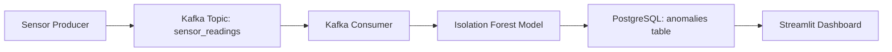
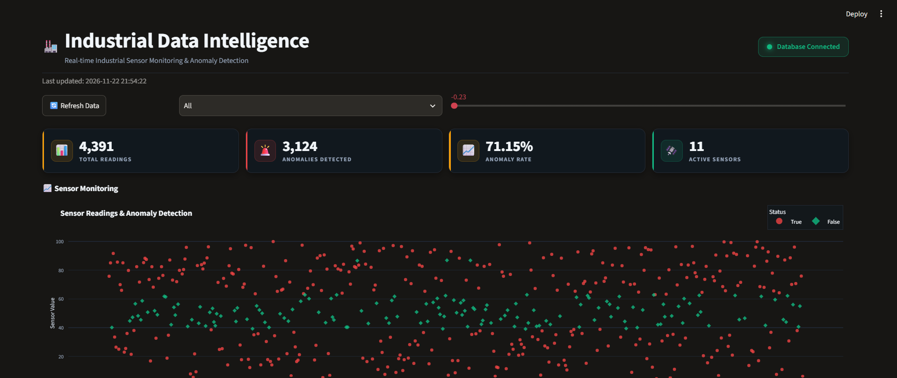
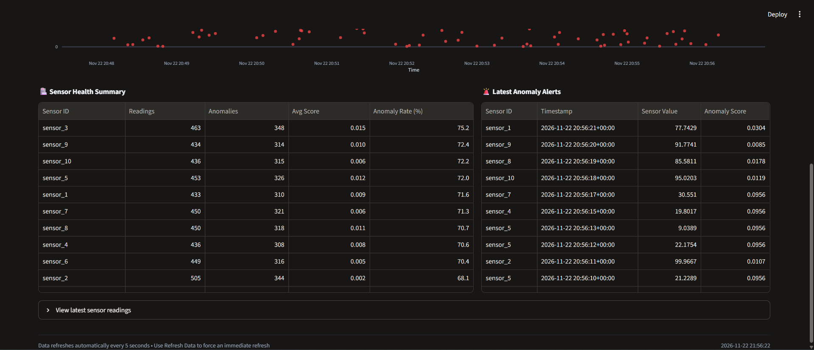

# Industrial Data Intelligence Platform

A modular, end-to-end platform for industrial IoT sensor monitoring. It ingests simulated sensor readings via Kafka, applies Isolation Forest anomaly detection, stores results in PostgreSQL, and visualizes normal versus anomalous readings in a Streamlit dashboard.

## Problem Statement

Industrial equipment generates continuous streams of sensor data. Detecting abnormal readings in real time is critical for preventing equipment failure, reducing downtime, and maintaining safety. This project demonstrates a complete anomaly-detection pipeline: stream ingestion, unsupervised machine-learning inference, persistent storage, and real-time visualization.

## Objectives

- Stream simulated industrial sensor readings through Kafka.
- Detect anomalies using a trained Isolation Forest model.
- Persist detected anomalies and raw readings to PostgreSQL.
- Visualize sensor trends, anomaly alerts, and per-sensor health in a dashboard.
- Provide a modular, extensible codebase suitable for extension to real sensor hardware.

## Architecture and Data Flow



1. **sensor_producer.py** — Publishes simulated JSON sensor readings (`sensor_id`, `timestamp`, `value`) to the Kafka topic `sensor_readings`.
2. **kafka_consumer.py** — Consumes messages from `sensor_readings`, runs Isolation Forest inference, and inserts results into the PostgreSQL `anomalies` table. Commits Kafka offsets only after successful DB insertion (at-least-once processing).
3. **train_model.py** — Trains an Isolation Forest (`contamination=0.1`) on synthetic normal and outlier data, and persists the model to `models/model.pkl`.
4. **streamlit_app.py** — Reads from PostgreSQL and renders KPI cards, a time-series scatter chart, per-sensor health summary, anomaly alerts, and recent readings. Auto-refreshes every 5 seconds via a Streamlit fragment.

## Technology Stack

| Layer | Technology |
|-------|------------|
| Stream ingestion | Kafka (KRaft mode), kafka-python |
| Anomaly detection | scikit-learn Isolation Forest |
| Storage | PostgreSQL 15, psycopg2-binary, JSONB |
| Dashboard | Streamlit, Plotly |
| Configuration | python-dotenv |
| Testing | pytest |
| Orchestration | Docker Compose |

## Key Features

- **Simulated sensor ingestion** — Produces readings for 10 sensors (`sensor_1` through `sensor_10`) at a 1-second interval.
- **Unsupervised anomaly detection** — Isolation Forest classifies each reading as normal or anomalous and computes a continuous anomaly score.
- **Reliable processing** — Manual Kafka offset commits after successful PostgreSQL insertion prevent data loss on consumer failure.
- **Real-time dashboard** — KPIs (total readings, anomalies detected, anomaly rate, active sensors), Plotly time-series chart with normal/anomaly coloring, per-sensor health table, top-20 anomaly alerts, and recent-readings expander.
- **Auto-refresh** — Dashboard refreshes every 5 seconds using `@st.fragment(run_every="5s")`.
- **Containerized infrastructure** — Docker Compose deploys Kafka and PostgreSQL.

## Dashboard Preview

| Overview | Details |
|----------|---------|
|  |  |

## Project Folder Structure

```
industrial-data-intelligence/
├── .env.example                 # Example environment variables (committed)
├── .gitignore                   # Git ignore rules
├── README.md                    # This file
├── requirements.txt             # Python dependencies
├── docker/
│   └── docker-compose.yml       # Kafka + PostgreSQL service definitions
├── db/
│   └── init.sql                 # PostgreSQL schema (anomalies table)
├── models/
│   └── model.pkl                # Trained Isolation Forest model (included)
├── src/
│   ├── settings.py              # Environment variable loading
│   ├── db/
│   │   ├── pool.py              # Shared psycopg2 connection pool
│   │   └── postgres.py          # insert_anomaly() database writer
│   ├── processing/
│   │   ├── anomaly.py           # Isolation Forest predict() wrapper
│   │   └── train_model.py       # Model training script
│   └── ingestion/
│       ├── sensor_producer.py   # Kafka producer (simulated readings)
│       └── kafka_consumer.py    # Kafka consumer (detection + DB insert)
├── apps/
│   └── streamlit_app.py         # Streamlit dashboard
└── tests/
    └── test_anomaly.py          # pytest suite for anomaly detection
```

### Model file

`models/model.pkl` is already included in the repository. You do not need to train the model before running the pipeline for the first time.

If you wish to regenerate the model with different synthetic data, run:

```powershell
py src/processing/train_model.py
```

Output: `Model saved to models/model.pkl`

## Prerequisites

- Windows with PowerShell
- Python 3.9+ (invoked via `py`)
- Docker Desktop (for containerized Kafka and PostgreSQL)
- `pip` (via `py -m pip`)

## Installation and Setup (Windows / PowerShell)

### 1. Clone the repository

```powershell
git clone <repository-url>
cd industrial-data-intelligence
```

### 2. Create the environment file

Copy the example environment file to a local `.env` (this file is gitignored and never committed):

```powershell
Copy-Item .env.example .env
```

Edit `.env` if you need to adjust host, port, or database settings. Do not commit `.env`.

### 3. Create a virtual environment (recommended)

```powershell
py -m venv .venv
.\.venv\Scripts\Activate.ps1
```

### 4. Install dependencies

```powershell
py -m pip install --upgrade pip
py -m pip install -r requirements.txt
```

### 5. Start infrastructure (Docker)

Ensure Docker Desktop is running, then start Kafka and PostgreSQL:

```powershell
docker compose -f docker/docker-compose.yml up -d
```

Verify containers are running:

```powershell
docker compose -f docker/docker-compose.yml ps
```

Kafka is exposed on `localhost:9092`; PostgreSQL on `localhost:5433`.

### 6. Run the pipeline

Open separate PowerShell terminals for each component:

**Terminal A — Sensor producer** (simulates readings):

```powershell
py -m src.ingestion.sensor_producer
```

**Terminal B — Anomaly consumer** (detects and stores anomalies):

```powershell
py -m src.ingestion.kafka_consumer
```

**Terminal C — Streamlit dashboard:**

```powershell
py -m streamlit run apps/streamlit_app.py
```

The dashboard opens at `http://localhost:8501` by default.

### 7. Stop the pipeline

Press `Ctrl+C` in each terminal to stop the producer and consumer. Stop Docker services:

```powershell
docker compose -f docker/docker-compose.yml down
```

## Testing

Run the pytest suite:

```powershell
py -m pytest tests/
```

The tests verify that:
- Normal sensor readings are classified as non-anomalous.
- Clearly anomalous readings are classified as anomalous.
- Anomaly scores increase monotonically with more extreme values.

The test suite trains the model via `train_model.main()` before running assertions.

## Current Results

- The pipeline trains an Isolation Forest model with `contamination=0.1` and persists it to `models/model.pkl`.
- The anomaly detection logic correctly separates normal readings (clustered around value 50) from extreme outliers (values 80–120) in unit tests.
- The dashboard renders KPI cards, a Plotly time-series chart, per-sensor health summary, anomaly alerts, and recent readings from PostgreSQL.

No production deployment metrics, latency benchmarks, or anomaly-detection accuracy figures are claimed. This is a demonstration project.

## Limitations and Future Improvements

### Limitations

- Sensor data is simulated; no real industrial hardware integration.
- Kafka and PostgreSQL must be run via Docker; no managed-service connectors are configured.
- The dashboard reads directly from PostgreSQL without an intermediate API layer.
- Model retraining is manual (run `train_model.py`); no automated retraining pipeline.
- No authentication, authorization, or TLS encryption for Kafka or PostgreSQL.
- Single-node Kafka (KRaft) with replication factor 1; not suitable for production fault tolerance.

### Future Improvements

- Connect to real industrial sensors (OPC UA, MQTT, or Modbus adapters).
- Add a FastAPI or Flask API layer between PostgreSQL and the dashboard.
- Implement automated model retraining on a schedule or drift trigger.
- Add user authentication and role-based access control.
- Configure TLS for Kafka and PostgreSQL connections.
- Deploy Kafka with multi-node replication for fault tolerance.
- Add alerting (email, Slack, PagerDuty) when anomalies exceed a rate threshold.
- Add data retention and downsampling policies for the `anomalies` table.
```
